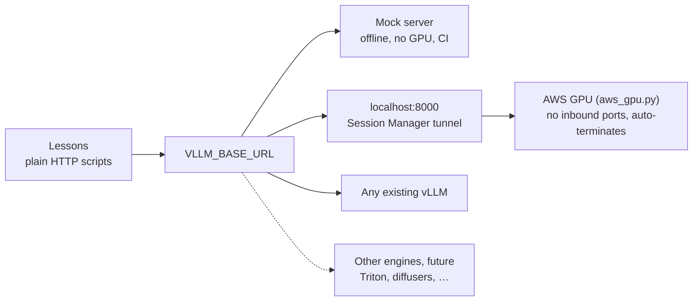

# vLLM Primer

[](https://github.com/deeplook/vllm-primer/actions/workflows/ci.yml)
[](LICENSE)
[](https://www.buymeacoffee.com/deeplook)

Small executable lessons for serving LLMs with [vLLM](https://github.com/vllm-project/vllm):
the OpenAI-compatible server, streaming, sampling, structured output, tool
calling, continuous batching, prefix caching and metrics. It is the GPU sibling
of `llamacpp-primer`: llama.cpp runs a quantized model on your laptop, vLLM
serves a model to many clients on an NVIDIA GPU.

Every lesson is a plain script that talks HTTP to a server at `VLLM_BASE_URL`.
That server can be a **mock** (offline, no GPU, used by CI), **vLLM on an AWS GPU
instance** that `tools/aws_gpu.py` launches for you, or any vLLM you already run.
Lessons skip cleanly when nothing answers.

## Why this exists

The value here isn't the vLLM content itself — it's the scaffolding around it.
The lessons, the mock server, and the disposable cloud infrastructure are fully
decoupled from whichever inference engine sits underneath. Swap vLLM for Triton
tomorrow and most of the repo survives unchanged. Most tutorials hard-wire the
tool into the teaching, so the moment the tool evolves or you want a second
engine, you start over. This one is a template for teaching any serving stack,
not just a single product.

The other half is the safety design: SSM-only access with no inbound ports or
SSH keys, an instance that terminates itself after a set number of hours, and
optional Spot instances with self-healing relaunch. That is the part people skip
when they write "just run this on a GPU" repos, and it is what makes this
something you can hand to a stranger without worrying they will leave a
hundred-dollar instance running.



## Setup

```bash
uv sync --all-groups
cp .env.example .env     # optional; every setting has a default
make check-all           # ruff + strict mypy + pytest, fully offline
make mock                # fake vLLM on :8000 (leave running)
make run EXAMPLE=examples/02_chat_completion.py   # in another terminal
```

Settings live in `.env` (see `.env.example`); real environment variables win.
**AWS credentials are never read from `.env`**: boto3 and the AWS CLI use `~/.aws`
(`credentials`, `config`, SSO). `AWS_PROFILE` and `AWS_REGION` may select a profile
or region, nothing more.

| Variable | Meaning |
|---|---|
| `VLLM_BASE_URL` | Server the lessons call (default `http://127.0.0.1:8000`) |
| `VLLM_API_KEY` | Only for servers started with `--api-key` |
| `VLLM_MODEL` | Model name to send (default: the first the server reports) |
| `VLLM_INSTANCE_TYPE`, `VLLM_SERVE_MODEL`, `VLLM_IMAGE`, `VLLM_SERVER_ARGS` | What `aws_gpu.py` launches |
| `VLLM_AUTO_TERMINATE_HOURS`, `VLLM_USE_SPOT`, `VLLM_VOLUME_GB` | Cost controls |
| `VLLM_HF_TOKEN` | Gated Hugging Face models only (stored as an encrypted SSM parameter) |

## Modules

| File | Topic |
|---|---|
| `01_check_endpoint.py` | `/health`, `/version`, `/v1/models`, `max_model_len` |
| `02_chat_completion.py` | Request/response shape, `finish_reason`, token usage |
| `03_streaming.py` | Server-sent events, time to first token |
| `04_sampling.py` | Temperature, `seed`, `n`, `logprobs` |
| `05_structured_output.py` | `response_format` with a JSON Schema |
| `06_tool_calling.py` | `tools`, `tool_calls`, returning a result |
| `07_batching.py` | Continuous batching: sequential vs concurrent throughput |
| `08_prefix_caching.py` | Reusing a shared prompt prefix, read from `/metrics` |
| `09_metrics.py` | Prometheus counters, gauges and histograms |
| `10_openai_sdk.py` | The official OpenAI SDK against vLLM |

## Running on an AWS GPU

Needs an AWS account with credentials in `~/.aws`, the `aws` CLI, and the Session
Manager plugin, which `make live-forward` uses to tunnel to the instance:

```bash
brew install awscli
brew install --cask session-manager-plugin
```

On other platforms see the AWS guide
[Install the Session Manager plugin](https://docs.aws.amazon.com/systems-manager/latest/userguide/session-manager-working-with-install-plugin.html).

Then:

```bash
make live-plan              # read-only: access, quota, price. Creates nothing.
make live-up YES=1          # launches the instance; billing starts
make live-wait              # until vLLM answers /health (image pull + model load)
make live-forward           # tunnel localhost:8000 -> instance (keep it open)
make live-run               # in another terminal: all lessons, for real
VLLM_PRIMER_CONFIRM=terminate make clean-remote INSTANCE=i-0123456789abcdef0
```

Last verified end to end: vLLM v0.33.0 on `g4dn.xlarge` (T4), `eu-central-1`, 2026-11-18.

**What it creates**: one `g4dn.xlarge` (NVIDIA T4, 16 GB, 4 vCPU), the smallest
single GPU vLLM supports (compute capability 7.5+), running the pinned
`vllm/vllm-openai` image on the AWS Deep Learning AMI with a 100 GB encrypted
volume; a security group with **no inbound rules**; an IAM role and instance
profile that only allow Systems Manager. Everything is tagged `Project=vllm-primer`.

**Cost**: about $0.66/hour On-Demand in `eu-central-1` (the list price `plan`
prints for your region), roughly half with `VLLM_USE_SPOT=1`. The instance
terminates itself after `VLLM_AUTO_TERMINATE_HOURS` (default 4, so about $2.60 at
most), but it bills until then: terminate it when you are done. `make live-status`
shows uptime and cost so far.

**Quota**: new accounts often have a vCPU quota of 0 for G instances. `plan`
reads it and tells you to request an increase (Service Quotas, "Running
On-Demand G and VT instances") if it is too low. `g4dn.xlarge` needs 4 vCPUs.

**Security**: the server listens on the instance's localhost only and is reached
through SSM Session Manager, so there are no open ports, SSH keys or API keys to
manage. IMDSv2 is required. A Hugging Face token, if you use one, is stored as an
encrypted SSM parameter and read by the instance; it is never in user data.
Prefer an SSO role over the account's root user: `plan` warns if you are on root.
See [Least-privilege access with IAM Identity Center](#least-privilege-access-with-iam-identity-center)
for the setup and a ready-made policy.

**Permissions** the calling identity needs: EC2 (describe, run/terminate
instances, create/delete a security group), IAM (create/delete the
`vllm-primer-ssm` role and instance profile, `PassRole`), SSM (parameters, run
command, start session), Service Quotas read, and Pricing read.

**Cleanup**: `clean-remote` terminates named instances (never untagged ones) and
needs `VLLM_PRIMER_CONFIRM=terminate`. `clean-remote-all` (`VLLM_PRIMER_CONFIRM=purge`)
removes the security group, role, instance profile and token parameter once no
instance remains. Generated local files: none besides `.env`. If something goes
wrong, look for instances, volumes and security groups tagged `Project=vllm-primer`.

Why `--dtype half`: the T4 predates bfloat16, and Qwen2.5 checkpoints default to
it. Larger GPUs (`VLLM_INSTANCE_TYPE=g5.xlarge`, A10G; `g6.xlarge`, L4) can take
`VLLM_SERVER_ARGS=--dtype bfloat16`.

### Least-privilege access with IAM Identity Center

Instead of the root user, give `aws_gpu.py` its own short-lived login. Identity
Center issues credentials that expire, so there are no long-lived access keys.

1. In the AWS console enable **IAM Identity Center** and create a user for yourself.
2. Create a **permission set** (say `VllmPrimerOperator`). As its inline policy paste
   the output of `make live-policy`; it is `tools/aws_gpu_policy.json` filled in for
   your account and region. Set the session duration (1-12 hours; 4 fits the
   instance's default lifetime).
3. Assign your user and that permission set to the account.
4. Create the profile and sign in; both write only to `~/.aws`:

   ```bash
   aws configure sso            # name the profile e.g. vllm-primer
   aws sso login --profile vllm-primer
   ```
5. Put `AWS_PROFILE=vllm-primer` in `.env`. Nothing else changes.

The policy allows only what the tool calls, in one region, on resources tagged
`Project=vllm-primer`; launches are limited to `g4dn.xlarge`, `g5.xlarge` and
`g6.xlarge`. A test fails if the tool starts calling anything the policy lacks, or
if the policy grants anything the tool does not use, and AWS's policy validator
reports no findings.

**Sessions**: the access-portal session (your `aws sso login`) lasts 8 hours by
default, configurable from 15 minutes to 90 days, and the CLI refreshes the role
credentials for as long as it is valid. The instance does not depend on your
credentials once launched (it terminates itself), but `down` needs a valid login:
run `aws sso login` again if it has expired. An idle `live-forward` tunnel closes
after 20 minutes (Session Manager default; adjustable up to 60).

**Residual risk**: the operator can create the one role `vllm-primer-ssm` and write
an inline policy on it (that is how the token is read), which could be abused to hand
that role more power. To close it, have an administrator create the role and its
instance profile once (same name, with `AmazonSSMManagedInstanceCore`, plus read
access to `/vllm-primer/hf-token` if you use a token), set `VLLM_INSTANCE_PROFILE`,
and remove the `ManageOnlyTheOneRoleAndProfile` and `AttachOnlyTheSsmManagedPolicy`
statements from the permission set. Keep `PassOnlyTheSsmRoleToEc2`.

## Testing

`make check-all` (`lint`, `typecheck`, `test`) is offline, needs no GPU, and never
modifies files. The tests run each lesson against the mock server and check
its structural assertions, check that every lesson skips without a server, and
exercise `aws_gpu.py` against fake AWS clients, including the safety latches (no
inbound rules, confirmation variables, only tagged resources). CI runs exactly
that plus `tools/test.sh` (curl against the mock).

The mock proves the lessons' client code, not vLLM's behaviour. Generated text
varies, so lessons assert structure (valid JSON, matching schema, repeatable
seeds, rising counters), never wording. For the real thing use `make live-run`.

CI never launches anything on AWS. A real run needs AWS credentials in the
repository's secrets and starts a GPU instance that costs about $0.66/hour, and CI
must stay free of secrets, paid services and cloud resources (see `primer-standards`).
It also means a pull request from a fork cannot spend your money. The real-GPU run is
a manual step: `make live-up YES=1`, then `make live-run`.

## Not covered

- Multi-GPU serving (tensor/pipeline parallelism), LoRA adapters, speculative
  decoding and quantization: these need larger or several GPUs.
- Offline batch inference with `from vllm import LLM`, vLLM's Python API without
  a server.
- Kubernetes, SageMaker and other managed deployments.

## Further reading

- [vLLM documentation](https://docs.vllm.ai/)
- [OpenAI-compatible server](https://docs.vllm.ai/en/stable/serving/openai_compatible_server/)
- [Tool calling](https://docs.vllm.ai/en/stable/features/tool_calling/) and [structured outputs](https://docs.vllm.ai/en/stable/features/structured_outputs/)
- [Metrics](https://docs.vllm.ai/en/stable/design/metrics/)
- [AWS Systems Manager Session Manager port forwarding](https://docs.aws.amazon.com/systems-manager/latest/userguide/session-manager-working-with-sessions-start.html)
